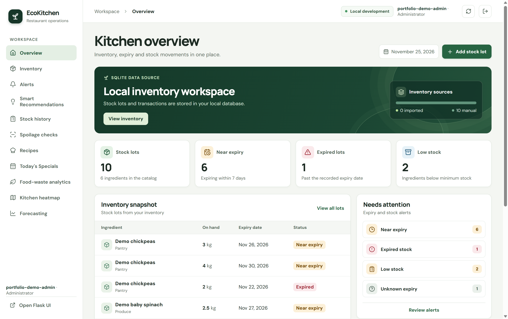
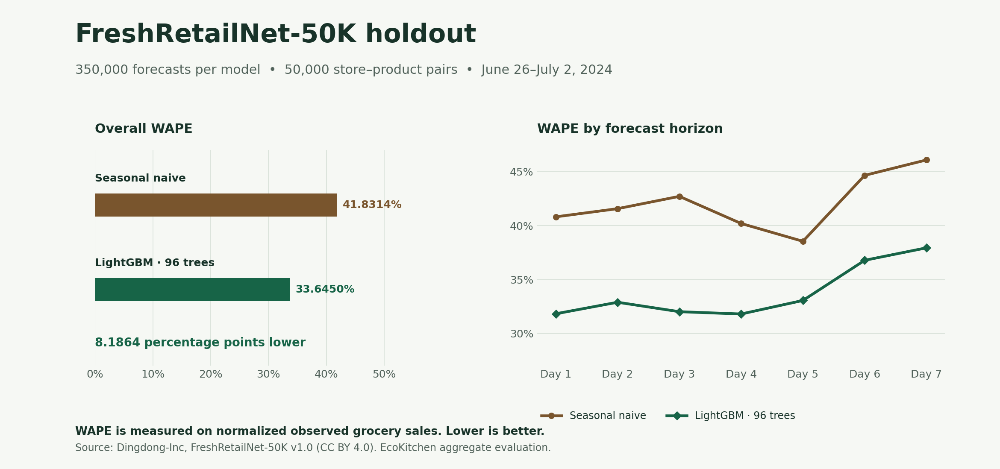
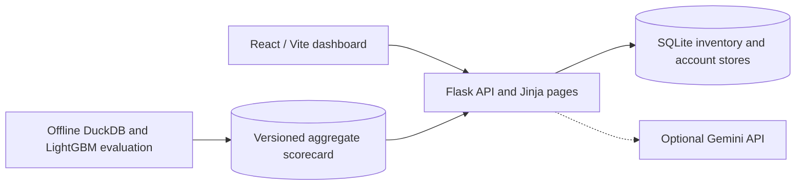

# EcoKitchen 2.0

EcoKitchen is a local restaurant inventory dashboard that helps staff see which lots expire first, what to replenish, and how a proposed stock change affects available quantities and purchasing estimates.

Expiry dates, physical stock, and reorder thresholds answer different questions. EcoKitchen keeps those records together, excludes expired and undated lots from recommendations, and explains the rules behind each suggestion. Staff can review a scenario before making any inventory changes.

[Windows demo](#serve-the-built-dashboard-on-windows) · [Demonstration](#demonstration) · [Retail forecast evaluation](#verified-retail-forecast-benchmark) · [Architecture](docs/architecture.md)

## What the application does

| Workflow | Implementation |
| --- | --- |
| Inventory operations | Search and manage ingredients and stock lots. Review expiry dates, low-stock alerts, and transaction history. SQLite records lot changes and their transactions together. |
| Smart Recommendations | First-expiring, first-out (FEFO) ordering, rule-based replenishment, and cost estimates when eligible lots have consistent recorded costs. What-if scenarios leave inventory unchanged. |
| Access control | Administrator and viewer roles, server-side session revocation, CSRF protection, explicit browser origins, and private media access. |
| Optional AI | Gemini supports recipes, menus, spoilage checks, and kitchen heatmaps when configured. Object detection and annotated waste-photo analysis are unavailable in this edition. |
| Research views | An offline FreshRetailNet grocery-sales benchmark and a separate synthetic waste predictor. Neither makes claims about restaurant demand or measured waste savings. |

## Demonstration



The local demo uses fictional kitchen records. The historical retail benchmark reads its own published evaluation scorecard.

[Stock lots](docs/screenshots/03-inventory-stock-lots.png) · [Expiry alerts](docs/screenshots/04-expiry-alerts.png) · [FEFO priorities](docs/screenshots/05-smart-recommendations-fefo.png) · [Replenishment and simulation](docs/screenshots/06-replenishment-and-simulation.png) · [Retail benchmark](docs/screenshots/07-retail-demand-benchmark.png) · [Mobile overview](docs/screenshots/08-mobile-overview.png)

[Three-minute walkthrough](docs/portfolio-demo.md) · [Screenshot details and credits](docs/screenshots/README.md)

## Verified retail forecast benchmark

FreshRetailNet-50K v1.0 contains **4.85 million grocery-retail records** across **50,000 store–product pairs**. EcoKitchen evaluated seven daily forecasts per pair on the official June 26–July 2, 2024 holdout, for **350,000 predictions per model**.

| Model | Official holdout WAPE |
| --- | ---: |
| Seasonal naive | 41.8314054769% |
| CPU LightGBM, 96 trees | **33.6450157277%** |
| LightGBM improvement | **8.1863897492 percentage points** |



Two chronological validation weeks informed model selection. The code uses only features available at the forecast origin and excludes target-day sales, stockout flags, future weather, and promotions. The selected model was frozen and refit through June 25. Both sets of holdout forecasts were saved and checksummed before the official labels were opened for scoring. The dashboard reads the versioned aggregate scorecard.

The target is **normalized observed grocery-retail sales**. Stockouts can suppress observed sales, so those observations do not reveal uncensored demand. This evaluation does not estimate restaurant ingredient demand or feed into replenishment. The dashboard requires no raw Parquet files, model checkpoint, or training run.

Dataset by **Dingdong-Inc**, FreshRetailNet-50K v1.0, CC BY 4.0. EcoKitchen derived aggregate metrics, charts, and stockout cohorts from the source. [Dataset card](https://huggingface.co/datasets/Dingdong-Inc/FreshRetailNet-50K) · [Yangyang Wang et al., 2025](https://arxiv.org/abs/2505.16319) · [CC BY 4.0](https://creativecommons.org/licenses/by/4.0/)

[Data and leakage audit](docs/freshretailnet-audit.md) · [Seasonal-naive baseline](docs/freshretailnet-baseline.md) · [Chronological LightGBM validation](docs/freshretailnet-lightgbm.md) · [Official holdout and reproduction commands](docs/freshretailnet-holdout.md) · [Versioned scorecard](forecasting/results/freshretailnet-holdout-v1.json)

## Architecture and stack

React and Vite provide the dashboard. Flask serves JSON APIs and the original Jinja pages. SQLAlchemy manages SQLite inventory, while a separate SQLite store handles local accounts and revocable sessions. Inventory recommendations run against stock lots. Optional Gemini integrations sit behind Flask. The separate offline DuckDB and CPU LightGBM workflow publishes an aggregate JSON scorecard for the read-only benchmark API.



The loopback Docker configuration uses Nginx and Gunicorn. [Detailed architecture](docs/architecture.md#system-diagram) · [Security design](docs/security.md) · [Docker and CI setup](docs/deployment.md)

## Local setup

From the repository root in PowerShell, use Python 3.11.

```powershell
py -3.11 -m venv .venv
.\.venv\Scripts\python.exe -m pip install -r requirements.txt
```

### Serve the built dashboard on Windows

The commands below start a **fictional demo** with isolated SQLite files under `instance/portfolio-demo/`. The build must already exist at `dashboard/dist` and target Flask port 5001. It can be produced on another computer, then copied locally. Serving it requires Python only.

Run in the first terminal. Choose a unique password at the hidden prompts.

```powershell
.\.venv\Scripts\python.exe -m tools.portfolio_demo
.\.venv\Scripts\python.exe -m flask --app tools.portfolio_demo:create_app create-user portfolio-demo-admin --role admin
.\.venv\Scripts\python.exe -m flask --app tools.portfolio_demo:create_app run --host 127.0.0.1 --port 5001
```

Run in the second terminal.

```powershell
.\.venv\Scripts\python.exe -m http.server 4173 --bind 127.0.0.1 --directory dashboard/dist
```

Open [http://127.0.0.1:4173/](http://127.0.0.1:4173/) and sign in as `portfolio-demo-admin`. Reuse the database by starting Flask directly on the next run. The [three-minute demo](docs/portfolio-demo.md) covers reseeding with a new directory, viewer accounts, and the walkthrough. For an empty inventory, run `flask --app app:app init-inventory-db`, create an administrator with `flask --app app:app create-user kitchen-admin --role admin`, and start the same loopback port with `app:app`. `flask --app app:app import-inventory` imports the independently authored sample CSV.

### React dashboard

On a build machine with Node 24.22.2, run from the repository root.

```powershell
Set-Location dashboard
npm ci
$env:VITE_API_BASE_URL = 'http://127.0.0.1:5001'
npm run build
```

The output is `dashboard/dist`. Git excludes generated builds. This repository distributes source only.

## API and tests

| API | Purpose |
| --- | --- |
| `/api/auth/login`, `/api/auth/session`, `/api/auth/logout` | Admin/viewer sessions and CSRF-protected sign-out |
| `/api/inventory`, `/api/inventory/ingredients`, `/api/inventory/alerts`, `/api/inventory/history` | Stock and ingredient operations, alerts, and transaction history |
| `/api/recommendations`, `/api/recommendations/simulate` | FEFO and replenishment, with read-only what-if calculations |
| `/api/forecasting/retail-benchmark` | Read-only aggregate holdout metrics and chart data |

The test suites use isolated databases and mocks for external providers. GitHub Actions runs the Python and React tests, builds Vite and both Docker images, and smoke-tests a disposable Compose stack. [Workflow](.github/workflows/ci.yml) · [Deployment guide](docs/deployment.md)

```powershell
.\.venv\Scripts\python.exe -m pip install -r requirements-ci.lock
.\.venv\Scripts\python.exe -m unittest discover -s tests -v
Set-Location dashboard
npm ci
npm test -- --maxWorkers=2
npm run build
```

## Read-only public demo

The dedicated Render Free image serves fictional inventory, recommendations, a saved menu, and the published retail benchmark. Review the cardless setup and resource verification steps before creating a service. [Render Free deployment guide](docs/render-free-deployment.md)

## Optional AI features

Gemini actions require a server-side key and an available model. Install `requirements-ai.txt` and use a local environment file based on `.env.example`. Missing keys or dependencies surface HTTP 503. Live provider behavior is unverified. The waste predictor was evaluated on synthetic data and requires a separately supplied local artifact. Restaurant demand forecasting remains unavailable with the partial fictional sales history.

This repository has no project-wide license. Third-party materials retain their own terms. [Third-party notices](docs/third-party-notices.md) · [Source publication checks](docs/public-release-verification.md)
