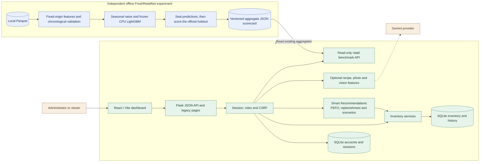

# EcoKitchen architecture

EcoKitchen runs locally as a React dashboard and a Flask application. Flask also serves the original Jinja pages. The dashboard uses hash navigation, so the Vite production bundle can be served by a static HTTP server alongside Flask. Flask manages inventory and a separate authentication database. See [Security](security.md) for the current access policy.

The Docker alternative serves a same-origin bundle and API through Nginx on a published loopback port. Gunicorn runs Flask inside the Compose network. A named volume stores the two databases, media, and menu history. See [Deployment](deployment.md) for prerequisites and recovery.

## System diagram



The runtime reads a verified scorecard. The Parquet files, feature construction, model training, and holdout scoring stay offline. The research path does not read or write the restaurant's inventory database. The local Flask landing page also remains available separately from the React UI.

## Application responsibilities

| Component | Responsibility |
| --- | --- |
| `app.py` | Composes Flask blueprints and keeps the original HTML routes, template endpoints, and legacy handlers. |
| `security.py`, `auth_store.py`, `local_api.py`, `reverse_proxy.py` | Authentication, server-side sessions and roles, CSRF, trusted origins, credentialed CORS, and exact-peer forwarding for Compose. |
| `runtime_config.py` | Repository-relative paths, root `.env` loading, lazy optional dependencies, and a cached Gemini client. |
| `inventory_api.py`, `inventory_context.py` | HTTP and CLI adapters, Flask database binding, and access to the current inventory store. |
| `inventory_db.py`, `inventory_service.py` | SQLAlchemy schema and session lifecycle, stock validation, transactions, queries, and CSV import. |
| `recommendations_api.py`, `recommendations_service.py`, `recipe_inventory.py` | Advisory expiry, FEFO ordering, replenishment, read-only scenarios, and eligible inventory inputs to recipes. |
| `vision_api.py`, `dashboard_ai_api.py`, `vision_media.py` | Dashboard routes and shared upload validation, allowlisted media, and local job storage. The route modules share helpers directly. |
| `spoilage.py`, recipe and menu modules, `heat_model.py` | AI processing and integrations behind the Flask adapters. |
| `forecasting_api.py`, `forecasting/retail_benchmark.py` | Local forecast and simulation routes plus validation and projection of the stored retail benchmark. |
| `forecasting/`, `forecasting/freshretailnet/` | Offline data loading, origin-bounded feature construction, model training, inference, evaluation, and reporting. |
| `dashboard/src/` | App shell, hash navigation, pages, and shared UI. `api.js` centralizes requests and the AI and Forecasting POST lifecycle. |

## Inventory and recommendations flow

1. React requests data through `dashboard/src/api.js`. Flask validates request inputs and uses the inventory store bound to the active app in `inventory_context.py`.
2. `inventory_db.py` controls SQLAlchemy sessions and SQLite write locking. The stock service keeps lot quantities and history updates together in the same write transaction. The schema contains ingredients, lots, and stock transactions. The CLI initializes the schema or imports the original CSV idempotently. There is no versioned database migration runner.
3. The legacy inventory page can read its CSV fallback when the SQLite file is missing. The JSON inventory API reports its existing setup error in that case.
4. Smart Recommendations reads stock and can simulate consumption without persisting changes. Eligible recipe and scenario lots have positive stock and known, unexpired dates. FEFO sorts by expiry and then lot ID. Replenishment and cost estimates follow the configured stock minimum and recorded unit cost rules. The inventory overview retains its own existing rules for undated lots.
5. Gemini recipe workflows explicitly request suggestions based on eligible inventory. The dashboard displays saved menu snapshots and calls Gemini only on an explicit generation or analysis action. Recommendations and AI output do not automatically change inventory.

## Vision and external services

The dashboard photo and video routes validate the supported file type and size. Photo validation also checks image dimensions and decoding. The shared media adapter isolates dashboard job files under `instance/vision/`. The Vision API serves an allowlist of assets for individual jobs. The original Flask upload and result routes keep their existing behavior and paths.

This candidate omits object detection and annotated waste-photo analysis. The affected upload paths return HTTP 503. Gemini uses the server-side key and model settings. Missing credentials or unavailable access can return HTTP 503, and inference failures can return HTTP 502. Live provider behavior was outside Phase 6A verification. The automated tests use mocks or absent configuration. Existing optional dependency and provider setup is documented in the [README](../README.md#optional-ai-features).

## Offline forecasting and the dashboard boundary

The weekly demand workflow and synthetic waste experiment live under `forecasting/`. The FreshRetailNet-50K pipeline uses local Parquet datasets and separates the seasonal-naive baseline, LightGBM validation, and official holdout. The holdout runner seals forecasts before reading the evaluation labels. See the [holdout report](freshretailnet-holdout.md) for reproducibility and source attribution.

`GET /api/forecasting/retail-benchmark` reads the versioned aggregate JSON scorecard. It does not need Parquet or model files. The React benchmark shows fresh-grocery observed-sales results in normalized retail sales units. Stockout-affected sales may understate actual demand. Those results have no write path into SQLite, FEFO, or restaurant replenishment.

## Local configuration and startup

| Setting | Boundary |
| --- | --- |
| `INVENTORY_DB_PATH` | Default `instance/inventory.sqlite3`. Relative paths resolve against the repository. |
| `INVENTORY_CORS_ORIGINS` | Comma-separated loopback origins. Defaults include dashboard ports 5173 and 4173. |
| `VITE_API_BASE_URL` | Frontend build or dev-server setting. Source default is `http://127.0.0.1:5000`. The Windows static build uses port 5001. Docker sets an empty value for same-origin requests. |
| `GEMINI_API_KEY`, `GEMINI_MODEL`, `GEMINI_RECIPE_MODEL` | Flask-side credentials and model selection. Keep keys out of frontend environment variables and Git. |
| Custom weights and local forecast artifact settings | Operator-provided model paths for optional inference. Snapshot and model files stay in local storage. |

For the built dashboard, run these from the repository root in two PowerShell windows. Python can serve the existing build on a host without Node or npm.

```powershell
.\.venv\Scripts\python.exe -m flask --app app:app run --host 127.0.0.1 --port 5001
```

```powershell
.\.venv\Scripts\python.exe -m http.server 4173 --bind 127.0.0.1 --directory dashboard/dist
```

Open `http://127.0.0.1:4173`. For source changes, the [development and build instructions](../README.md#react-dashboard) cover Vite, and the [benchmark instructions](../README.md#serve-the-built-dashboard-on-windows) reproduce the port-5001 bundle.

## Phase 6A repository audit

- **Before.** Inventory consumers depended on a route module to resolve the database. Gemini photo routes depended on the Vision blueprint module for shared upload code. Local-only blueprint guards and React AI and Forecasting request state were duplicated.
- **Baseline verification.** The starting branch was `feature/ecokitchen-v2` with existing worktree changes. Before refactoring, 67 backend tests, 27 frontend tests, and the Vite production build passed. The local integrity manifest is written to ignored `instance/phase6a-integrity.json`.
- **After.** Flask database binding, shared media helpers, loopback guard registration, and POST action state each have an explicit shared home. Feature-specific validation, inference, responses, routes, offline experiment algorithms, and presentation remain with their original owners.
- **Remaining code debt.** The legacy route layer in `app.py` still owns several HTML workflows, media conventions, and error handlers. The `inventary.py` name and `forcasting/` historical experiments remain for compatibility and reproducibility. Vision and simulation submissions still have feature-specific state machines. A future schema upgrade needs migrations and a tested recovery strategy.
- **Repository hygiene.** Local configuration, databases, downloaded external data, new uploads, logs, caches, builds, and model artifacts belong outside Git. Keep versioned scorecards, tests, documentation, and reproducibility configuration. The candidate uses independently authored fictional fixtures. Historical samples remain in the original workspace.

## Priorities for Phases 6B–6D

1. **6B security.** The account, role, session, CSRF, and upload boundaries are in place. See [Security](security.md) for the pre-change audit and remaining deployment limitations.
2. **6C deployment and CI.** Compose defines the Nginx/Gunicorn stack, first-run initialization, persistent state, and health checks. GitHub Actions runs the suites, build, repository checks, and a disposable Compose smoke test. See [Deployment](deployment.md).
3. **6D final quality assurance.** Verify the Compose stack from a clean checkout and in desktop/mobile browsers, rehearse backup and recovery, and check optional providers with fixtures. Verify TLS and rate limiting in a controlled environment before any network deployment. Keep expensive dataset runs separate from ordinary CI.
